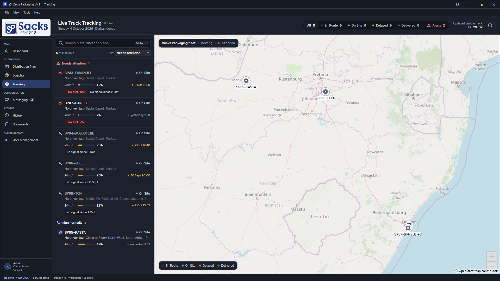
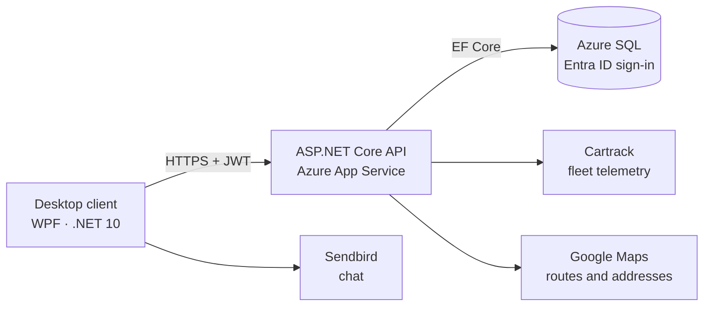
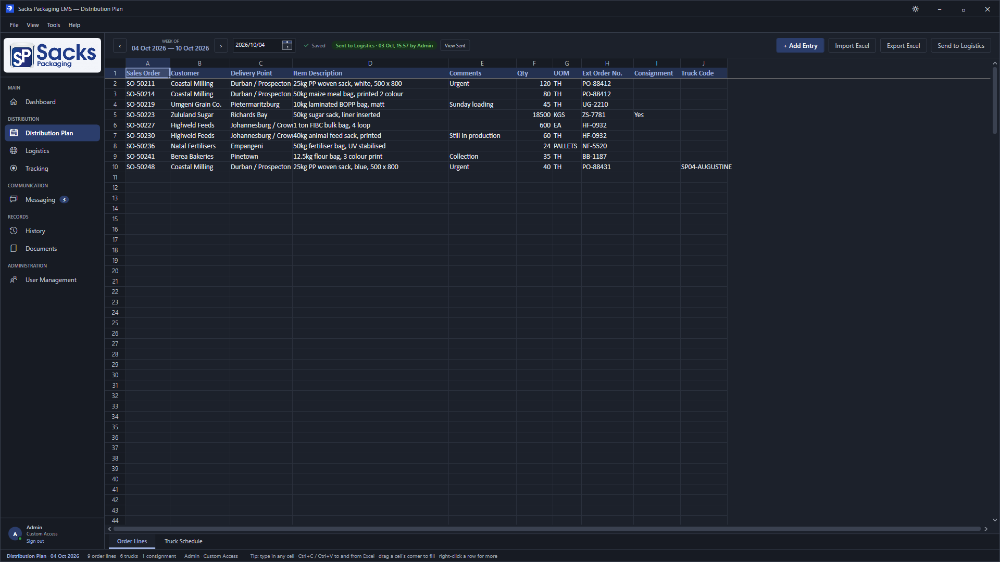
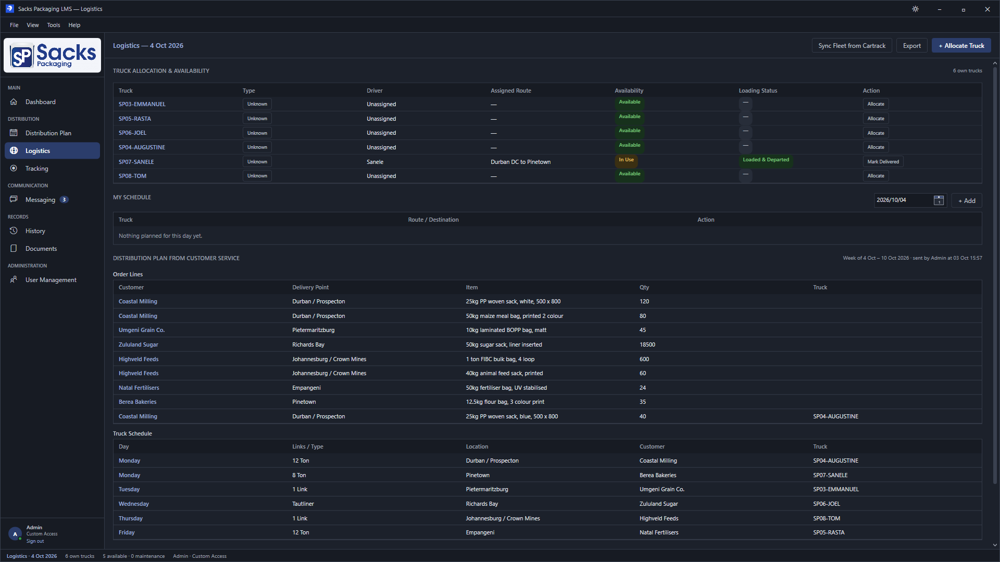
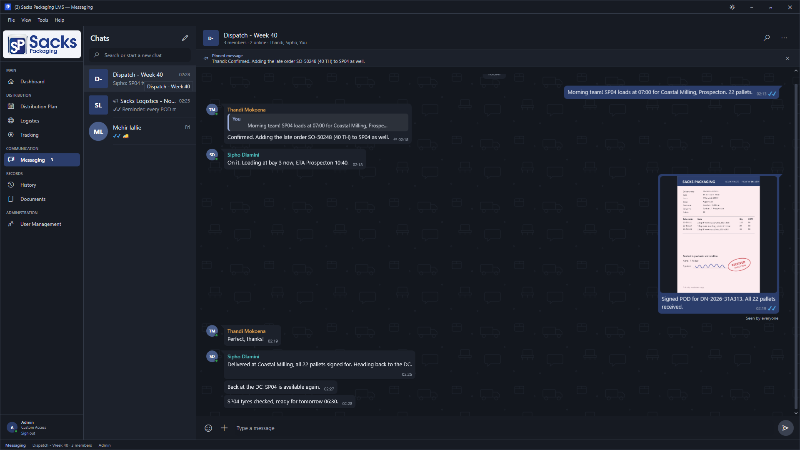
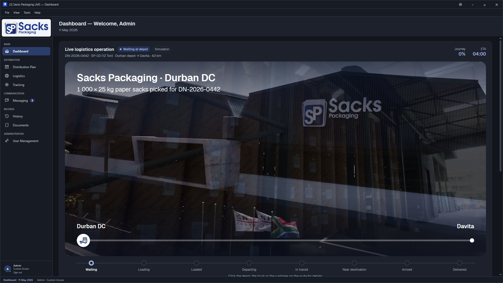
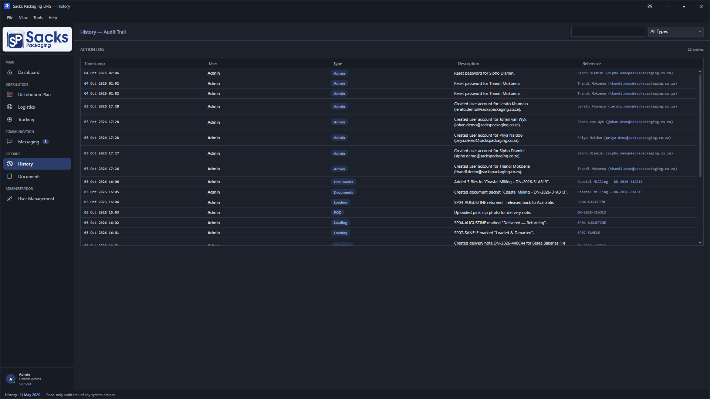
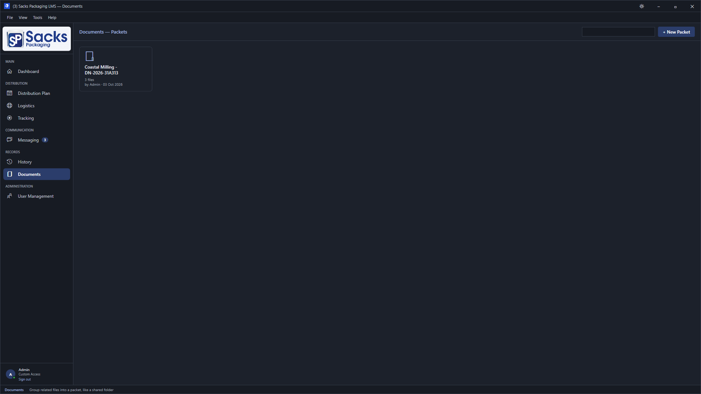

# Sacks Packaging LMS

A logistics management system for Sacks Packaging, a Durban packaging manufacturer. It replaces a shared spreadsheet, a second fleet sheet and WhatsApp status updates with one Windows desktop app backed by an API and database on Microsoft Azure.

Built by a team of six, which I lead, as our INSY7315 Work Integrated Learning project (2026). This repository is a showcase: screenshots, architecture and a summary of my part in it. The source is in a private repository and is **available on request**.

**Watch:** [presentation video](https://youtu.be/2Im0VTIoqD8)

## What it does

| Area | What the team can do |
|---|---|
| **Distribution plan** | Customer service builds the week's plan in a spreadsheet-style grid, imports order lines from Excel, and hands the plan to logistics in one action. |
| **Logistics** | Dispatch allocates trucks to drivers and routes. A truck that is already out cannot be allocated again. Each load moves through loading, departed, delivered and returned. |
| **Proof of delivery** | The signed delivery slip is uploaded against its delivery note and the note is marked received. |
| **Live tracking** | Vehicle positions, speed, fuel and trip history from the Cartrack fleet API on Google Maps, with distance and ETA to the delivery point. |
| **Messaging** | Private and group chats with replies, reactions, read receipts, pinned messages, search, photo sharing and announcement groups. |
| **Records** | Document packets per delivery, a searchable audit trail of every action, and per-screen access for each user. |

## My role

I lead the team and work across the client, the API and the database. The main pieces:

**Leading the team**
- Planned the project, assigned work across the team of six and made the key technical and design decisions.
- Worked with the client's staff to rework how they plan and dispatch, and turned that into the Distribution Plan and Logistics board.

**Core screens**
- Built the Distribution Plan, Logistics and Messaging screens, the ones staff use every day to plan orders, dispatch trucks and talk to each other.

**Live fleet tracking**
- Connected the tracking screen to the Cartrack API so the truck list and map are built entirely from live data, polled every 5 seconds.
- Replaced the illustrated map with a real map (first OpenStreetMap, now Google Maps), with selectable trucks, a detail panel and a depot marker, kept to southern Africa with cached tiles so it opens fast.
- Added telemetry (road speed, RPM, odometer, battery, fuel level), trip history, geofence-based status and a fuel-theft alert.
- Added distance and ETA from a truck to its cargo's destination, including fixing geocoding that matched the wrong place.

**Moving the app onto a real backend**
- Designed and built the ASP.NET Core API and the EF Core data layer, then migrated the app off local files one area at a time: truck allocation, truck schedule and order lines, audit history, users and sign-in, documents (with real file upload and download) and the distribution plan.
- Moved the database from SQLite to Azure SQL and added JWT sign-in, with passwords verified on the server.
- Enforced per-screen permissions on the server, so access is checked on every request and not only hidden in the menu.
- Introduced repository interfaces over EF Core and made multi-step saves run inside EF's execution strategy so they survive transient Azure SQL failures.

**Planning and dispatch workflows**
- Made "Send to Logistics" hand the plan's data to the logistics screen, and built the Excel import against a real customer-service file.
- Removed the hard-coded fleet: trucks sync from Cartrack's vehicle roster, delivery notes are created on allocation, and an allocated truck progresses through its stages.
- Added a per-dispatcher planning calendar, address autocomplete and a real logistics export.
- Rebuilt the Distribution Plan as a live, day-by-day plan grouped and colour-coded by delivery region, with a weekly Logistics board showing each sent day.
- Moved maps, routes and address suggestions to Google Maps, with OpenRouteService as the fallback.

**Releases and hosting**
- Added Velopack auto-updates with delta packages, cutting each update from about 110 MB to 20 MB, and an update check at launch.
- Made releases tag-driven: the annotated tag names the release and writes its notes.
- Moved the hosted API and database to a new Azure subscription.

**Performance and polish**
- Shared one connection pool across the API clients, read list queries without change tracking and stopped polling while the app is minimised.
- Made the window fit small screens and stay sharp at any display scaling; redesigned History, Documents and the Logistics header; designed a new app icon.

**Messaging**
- Added a Photos gallery for every chat and saved each chat's last 50 messages so chats open instantly.
- Polished the chat experience and fixed an unresponsive compose box, a slow emoji picker and reactions that vanished for other users (traced to a Sendbird SDK defect and worked around with a server re-fetch).

**Quality**
- Wrote integration tests for truck allocation and the distribution-plan save, running against a real SQL Server container.
- Added Sonar static analysis and Snyk dependency scanning to the CI pipeline.

## Architecture

- **Six projects:** desktop client, tracking module, shared UI, API, data layer and API tests.
- **Database:** 10 tables in Azure SQL. The API signs in with a managed identity, so no database password is stored.
- **CI/CD:** GitHub Actions builds on Windows, runs 138 automated tests on Linux against a real SQL Server, runs Sonar and Snyk, and deploys the API to Azure on merge to `main`.

**Stack:** C#, .NET 10, WPF, ASP.NET Core, Entity Framework Core, Azure SQL, Azure App Service, JWT, xUnit, Testcontainers, GitHub Actions, Sendbird, Cartrack API, Google Maps Platform, Velopack.

## Screenshots

| Distribution plan | Logistics |
|---|---|
|  |  |

| Messaging | Dashboard |
|---|---|
|  |  |

| Audit trail | Documents |
|---|---|
|  |  |

Screenshots show sample data.

## Team

Built by Bit&Byte: Mishen Naidoo, Ezekiel Isaac Narayansami, Tylen Govender, Prean Govender, Mehir Lallie and Ethan Kistan.

Work I did not do and want to credit: Mehir Lallie set up the Azure hosting and the CI/CD pipeline and built the security hardening, dark mode, accessibility work and the dashboard film. Tylen Govender built the original JWT sign-in and user management. Teammates built the original Sendbird messaging integration.

## Source code

The code is private because it was built for a client. If you would like to see it, contact me and I will give you access or walk you through it.

Ethan Kistan · ethankistan25@gmail.com
